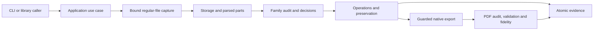

# Architecture

The root application API owns use cases. Family implementations own semantics and permitted
edits; generic orchestration consumes their contracts without selecting family XML.

## Follow the ownership

| Owner | Responsibility |
| --- | --- |
| `application`, `tools`, `outcomes` | Root use cases, selected tools, typed stages/progress/exit precedence. |
| `odf`, `source_capture` | Storage, kinds, shared logical parts, protection/access gates, schema validation and bound bytes. |
| `decisions`, `plans`, `serialization` | Registered answer contracts, target grammar, source binding, one codec and record/schema serialization. |
| `adapter`, `families` | Abstract family contract and registry; immutable preservation snapshots and explicit optional capabilities. |
| `content` | Shared ODF vocabulary, identities, references, styles and protected XML primitives. |
| `families.text` | Contexts, lists, references/notes, effective language, classified tables, visibility, headings, graphics and spacing. |
| Other family packages | Spreadsheet data; shared presentation/drawing pages; MathML; chart data; image payloads; database declarations. |
| `source_audit`, `remediation` | Read-only inspection/plan preparation and guarded candidate execution. |
| `native` | Bounded process control, resource/formula preflight, export and scoped capability probes. |
| `pdf.reading`, `pdf.fidelity`, `pdf` | Shared bounded consumption, structural PDF inspection, comparison and independent validation. |
| `pipeline`, `batch`, `evidence` | Assurance stages, serial items, review records, redaction and atomic publication/integrity checks. |
| `report`, `cli` | Registered rules/facts and rendering; argument translation and terminal presentation. |

[tach.toml](../tach.toml) owns dependency/interface edges. The CLI imports the root API,
stdlib and its own helpers. Families do not import one another; lower layers do not import
families. A small test rejects family XML literals in orchestration. Function complexity
and module responsibility are reviewed separately; see [development checks](DEVELOPING.md#required-checks).

## Work with a document

`OdfDocument.tree(part)` returns the cached mutable tree. Package members parse once;
flat logical parts share one tree. Content checkpoints compare full serialization digests,
including QName-only namespace bindings, and invalidate derived caches between mutations.
An operation can update its own catalogue while running. Replacing raw storage behind a
cached tree refuses and requires reopening. [Measurements](verification/0.8.0-digests.json)
explain the serialization choice.

`require(Use)` centralizes audit/plan/remediation/native access. Audits translate blocked
views into findings without selecting protected body XML. Saving serializes changed trees
only, retains untouched members and keeps ZIP `mimetype` first/uncompressed. Direct model
editing does not execute guarded-remediation postconditions.

## Make and apply decisions

A `DecisionKind` owns scope, answer dataclass/constraints, families and operation identity.
`OpenDecision` provides current values and a canonical target/fingerprint; `Decision`
contains the reviewed answer. Document choices bind through the source header. One stdlib
codec derives parsing, disabled templates, schemas and reference text.

Each adapter implements audit/snapshot and supplies operation-specific protection,
whole-plan preflight, answer translation and human review. Operations return every
`applied`/`unchanged`/`failed` outcome. The engine refuses foreign-family decisions,
protected/opaque changes, semantic operation failures and newly detected schema violations;
it publishes a passing whole candidate atomically. See [preservation](ACCESSIBILITY.md#preservation-boundaries).

Presentation/drawing share `families.pages`; profiles retain genuinely different contexts
and wording. Other families own distinct contracts rather than a universal document model.
Eight-family conformance tests cover decision round trips, rebind/idempotence, preservation,
blocked packages, audit non-mutation and serialized schemas.

## Cross the native boundary

`native` owns shared process/resource/formula policy. Original and captured exports have
different identity requirements; [evidence capture](EVIDENCE.md#source-capture) defines them.
Probes distinguish supported/unsupported output from execution failure. Batch caches key
conclusive results by selected executable identity and probe definition; doctor measures all.
[Capabilities](CAPABILITIES.md) retain actual observations.

PDF audit and fidelity share bounded stream reading and structure/marked-content ownership.
Unsupported/incomplete inspection remains explicit. These guards do not sandbox native
applications; [accessibility boundaries](ACCESSIBILITY.md) own limits and human acceptance.

## Deliver the contract

Findings reference registered `Rule` objects; reports expose registered `FactKey` values.
Typed records declare serialization and generate [published schemas](SCHEMAS.md).
`tools.generate_reference --check` verifies generated interfaces in CI.
`pyproject.toml` owns version/build/dependency declarations, `uv.lock` restores Python inputs,
and workflows pin native installers/actions. See [packaging](DEVELOPING.md#packaging).
