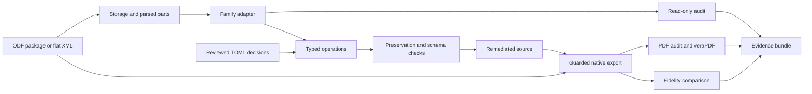

# Architecture

The ODF core owns document storage and standard structure. Family adapters own the
meaning of text, spreadsheet, presentation, drawing, formula, chart, image and database
documents. Shared ODF primitives live in `content`; orchestration does not select family
XML or decide family semantics.

## Packages and dependency rules

| Package | Responsibility |
| --- | --- |
| `odf` | Package/flat storage, logical parts, document kinds, protection declarations and schema validation. |
| `adapter` | Family, operation, outcome and review contracts. |
| `content` | Shared ODF text, language, graphics, links, tables, resource context and protected XML primitives. |
| `families.<family>` | Family audit rules, explicit operations, protected-content policy, registered answers and native capabilities. |
| `families` | Adapter registry and supported style inspection. |
| `source_audit`, `remediation` | Read-only source source inspection/plan preparation and guarded operation execution. |
| `pdf` | Structural PDF inspection, validation, shared bounded reading and fidelity comparison. |
| `evidence` | Manifests, redaction, review sheets and atomic bundle publication/verification. |
| `decisions`, `plans` | Registered answer contracts, canonical targets, source binding and one strict codec/schema/reference. |
| `source_capture` | Bounded regular-file snapshots shared by planning, remediation and pipeline execution. |
| `pipeline`, `batch` | Public document workflows, assurance stages and serial manifest execution. |
| `report` | Rule registry, findings, reports, rendering, SARIF and command statuses. |
| `cli` | Argument translation, terminal output, progress and recovery guidance. |
| `safe_xml`, `staging` | Secure XML parsing and atomic output paths. |
| `native` | Bounded process control, resource/formula export preflight, export and capability checks. |
| `pdf.reading`, `pdf.fidelity` | Shared PDF budgets/scanning/preflight and publication comparison. |
| `errors` | Domain exceptions reported by application boundaries. |

[tach.toml](../tach.toml) is the dependency authority. The CLI calls public core
operations and cannot import family implementations, document storage or the PDF engine.
The registry selects adapters; families never import one another, and lower layers do
not import family implementations. PDF reading limits, scanning and consumption are explicit
internal boundaries shared with fidelity. Native resource and process leaves stay below
export/probe consumers, avoiding package cycles. The adapter depends on shared outcomes and
domain errors; its ODF/report annotations are type-only references.

Tach rejects undeclared or unused dependencies, cycles and imports that bypass package
interfaces. An interface exposes the names re-exported by its `__init__.py`. The package
root exposes only `__version__`; `__main__` is the explicit caller of the CLI. Unregistered
files inherit the root's empty dependency list, and unregistered top-level modules cannot
import project packages.

The architecture tests also reject literal family XML selection in orchestration, including
qualified-name calls, ordinary aliases and XPath literals. Shared `content` primitives
may name their vocabulary. Storage dispatch, namespace declarations and normative schema
selection remain core responsibilities. Static checks cannot establish semantic cohesion:
design review must assess responsibilities, state ownership and downstream effects.

The authored-file inventory includes hidden and Git-ignored Python. Generated environments,
caches and root distribution/build outputs are excluded; nested domain directories named
`build` or `dist` remain authored source. [pyproject.toml](../pyproject.toml) owns function-complexity, lint and type settings. See [Development](DEVELOPING.md#required-checks).

## The document model

[OdfStorage](../src/odfa11y/odf/storage.py) exposes logical parts (`content`, `styles`,
`meta`, `settings`, `manifest`) over package members or one flat XML tree.
[OdfDocument](../src/odfa11y/odf/document.py) parses a member once and shares its mutable
cached tree between checks and operations. `tree(part)` needs no edit declaration:
checkpoints compare full XML serialization digests before/after each operation. Newly
parsed unchanged parts do not count as edits. Full serialization retains namespace
bindings used only in attribute values, which C14N 2.0 can discard; see the
[measurement and counterexample](verification/0.8.0-digests.json).

Checkpoints invalidate derived family state when observed trees change. An operation may
update its own catalogue while it runs; the next operation receives fresh derived state.
Replacing stored XML behind an already cached tree refuses and requires reopening the
model. The parsed tree and its raw identity come from one securely parsed byte buffer.

`save()` serializes only changed trees; untouched member payloads remain byte-identical.
Flat logical parts share one tree. Storage validates output and publishes atomically;
package output keeps `mimetype` first and uncompressed. Corpus tests assert that audits
change neither live trees nor source bytes.

`document.require(Use)` owns protection/access decisions for audit, planning, remediation,
native export and style inspection. Blocked views raise `PackageError`; audit translates
those declarations into source findings without inspecting protected body content.

Protection declarations are inspected before semantic XML selection. Signed packages can
be inspected without establishing signature validity, but remediation refuses them even
for dry runs and empty plans. Encryption, duplicate/unsafe member names and malformed or
ambiguous protection declarations prevent complete inspection and guarded planning,
remediation and native work. See [preservation boundaries](ACCESSIBILITY.md#preservation-boundaries).

### Kinds

[kinds.py](../src/odfa11y/odf/kinds.py) defines supported media types, families, template
flags and body elements. Detection reads package `mimetype` or flat `office:mimetype`,
falling back to a package manifest declaration. Manifest/body disagreements are findings;
the extension corroborates the declaration and never selects a family. An unknown media
type stops semantic audit with `ODF005`. Database uses the standard
`application/vnd.oasis.opendocument.base` media type. The standard Image kind is recognized
and reported as deprecated by ODF.

## Document families

A [FamilyAdapter](../src/odfa11y/adapter/family.py) requires audit and typed preservation snapshots,
with explicit methods for optional capabilities and language targets. It supplies
operation-specific guards, whole-plan preflight,
decision kinds, typed answer translation and human-review items. It also declares an optional PDF
filter, style report and link-capability probe. The generic adapter performs common checks
for an unimplemented kind and reports the absent semantic audit explicitly.

| Family implementation | Semantic ownership and protected content |
| --- | --- |
| `text` | Current reading contexts, headings, logical table headers, graphics, links, addresses, spacing and inert spacers; wording, references, excluded content and unrelated styles remain protected. |
| `spreadsheet` | Sheet names, graphic decisions and link descriptions; sheet positions, values, formulas, grids and other sheet XML remain protected. |
| `pages` (presentation, drawing) | Page descriptions, graphic decisions and explicit complete navigation order; page/shape identity, visible text, geometry, links and payloads remain protected. The drawing adapter serves ODF's `graphics` family. |
| `formula` | Spoken alternative and root language on packaged native MathML; expression structure, annotations, references and other attributes remain protected. An office-body Formula wrapper is outside this contract. |
| `chart` | Labels, cached ranges/series and source consistency; its nonvisual alternative uses common document metadata. Chart body data, types, values and references remain protected. |
| `image` | Graphic identity, supplied alternatives/roles and payload inspection; graphic content, geometry and resource identity remain protected. |
| `database` | Offline connection/privacy and object-description checks; SQL, connection settings, form bindings and embedded storage remain protected. No connection or query is executed. |

Native export capability is separate from source semantics. The current family/export
matrix and exporter limits live in [Accessibility scope and limits](ACCESSIBILITY.md#document-families).
Configuration fields, selectors and fingerprints live in [Configuration](PLAN.md).

### Adding a family

1. Implement its adapter, audit, operations, decision kinds and review items under
   `families/<family>/`. Define default-language semantics and precisely which content an
   operation may change.
2. Register the adapter and declare its actual dependencies and public interface in
   `tach.toml`.
3. Register findings and keep [Rules](RULES.md) synchronized with the rule registry.
4. Test supported representations, rejected/ambiguous inputs, complete preflight,
   idempotence and preservation. Use real native documents and export evidence for any
   claimed native capability; do not require a flat representation the standard/adapter
   does not support.

Family selection stays in the registry; generic engines consume the contract without
family-specific branches. Operations addressed to another family are refused.

## Operations and preservation

An [Operation](../src/odfa11y/adapter/operation.py) is a frozen dataclass with parameters,
`apply(document)` and a serialized operation record. It returns per-target `applied`,
`unchanged` or `failed` outcomes. Repeating a supported reviewed decision is idempotent.
A source-bound TOML plan carries answered decisions and a fidelity policy. Explicit rebind permits a different source digest while target identities and preservation guards still apply.

Addressed operations such as graphic, heading, table-header and spacing edits resolve and
validate their targets before mutation. Missing, ambiguous or stale identities refuse.
Heading edits change only the explicit outline level. Table-header decisions use logical
row/column counts, including repetitions and groups; crossing spans refuse. A repeat split
that would duplicate structural objects or XML/drawing identities also refuses.

The [executor](../src/odfa11y/remediation/apply.py) checks family applicability and optional
whole-plan preflight, then checks operation-specific protection after each operation.
Edit accounting applies per operation: reporting an applied outcome requires an actual
XML change, while an unchanged operation must make none. Failed outcomes prevent publication.
Final checks compare family snapshots, counted inert-spacer removals and opaque resources.
Opaque package members outside standard editable parts and flat embedded binary payloads
are protected separately.

Protected XML digests include structure, attributes, references and in-scope namespace
bindings used by attribute values. Families omit only explicitly editable metadata;
copying XML must not erase a formula prefix's meaning. Graphic target identities include
subtree/resource/style facts, while reviewed accessibility metadata is excluded where
needed for idempotence. The public preservation scope and its limits are described in
[Accessibility](ACCESSIBILITY.md#preservation-boundaries).

Explicit metadata decisions can create a missing optional package metadata part for a
declared supported ODF version. Creation preflights the storage slot and manifest,
refuses duplicate/conflicting declarations and never overwrites a resource. Database
description edits use only the standard declared-object description attributes.

Successful remediation writes atomically to a destination distinct from the source. A
failure or dry run writes no destination. Direct low-level model editing remains the
caller's responsibility; it does not automatically execute the remediation postconditions.

## Schema validation

The bundled OASIS ODF schemas and W3C MathML grammar retain their notices and recorded
digests. Validation is offline. Remediation compares schema violations when the result's
version has a bundled schema. If only the result has one, it must validate outright; if
the result has none, the result records a skipped schema check rather than conformance.

Violations are matched as a multiset of message/element fingerprints, including the
element, attributes, parent and neighboring tags. Fixing one location cannot hide the same
reported violation introduced elsewhere. libxml2 may expose only one failure within an
already failing content model; unlocated violations are compared by count. See
[schema assurance limits](ACCESSIBILITY.md#odf-schema-validation).

## Native and PDF boundaries

Application operations share native-resource/context preflight from `content`. They
distinguish rendering dependencies from navigation and exact package files from embedded
subdocument directories. Original export and captured pipeline export have different
identity requirements. The authoritative supported declarations, Formula bounds and
refusals live in [Accessibility](ACCESSIBILITY.md#native-document-context-and-declared-dependencies);
capture identity and directory-lifetime requirements live in [Evidence](EVIDENCE.md#source-capture).
The low-level `native.export.export_pdfua()` call requires caller policy and isolation.

Native processes use argument lists, validated timeouts, bounded output capture and
temporary LibreOffice profiles. Process cleanup has platform limits; these controls are
not a sandbox. [process.py](../src/odfa11y/native/process.py) owns native process
handling and [pdf/export.py](../src/odfa11y/native/export.py) owns LibreOffice export.

The PDF structure walker builds reachable structure and reconciles page/Form marked
content and link-object references. [pdf/reading/content/scan.py](../src/odfa11y/pdf/reading/content/scan.py)
owns bounded tokenization and inline-image boundaries. Audit and fidelity share decoded
stream/work preflight. Unsupported content produces explicit incomplete inspection or
failure. Graphic-presence checks establish inspected painted content rather than pixel
visibility. Detailed budgets and uninspected cases belong to
[Accessibility](ACCESSIBILITY.md#threat-model).

## Pipeline and evidence

Public pipeline operations own document dispatch, guarded native export, comparisons,
scratch lifetimes and assurance stages. The CLI translates arguments and renders results.
`Tools` selects native executables and timeout; a `Profile` value selects run assurance. Optional observers receive typed ProgressEvent values without document payloads
and must not raise. They do not alter persisted records, plan hashes or gate policy.

`run_pipeline` executes a fixed stage order and stops at a failed gate. Stage status
distinguishes success, failure, skipped work and unsupported/not-applicable work. An
acceptable output directory receives a bundle for passed and failed runs, including
unreadable sources. Publication progress completes only after atomic bundle publication.
Bundle manifests identify final staged bytes; hashes establish identity, not review
quality. See [Workflow](WORKFLOW.md), [Evidence](EVIDENCE.md), [Batch](BATCH.md) and
[SARIF](SARIF.md) for their public contracts.

## Packaging

[pyproject.toml](../pyproject.toml) owns metadata, dependency/tool constraints, analyzer
policy and Hatchling build selection. `[project].version` is the version authority;
runtime reporting derives installed distribution metadata. The wheel includes runtime
resources and `py.typed`; source archives include contributor materials. See
[Development](DEVELOPING.md#packaging) for distribution verification.
